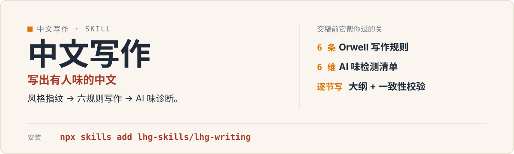

<p align="center">
  
</p>

# lhg-writing · 中文写作

写出清晰、有观点、有人味的中文成稿：按体裁定调，提炼你的风格指纹，逐节写、再过 AI 味诊断与一致性校验。

（SKILL.md v1.1.2）

## 它是什么

- 按体裁定调 → 风格指纹提取 → 大纲逐节写作（Orwell 六规则硬约束）→ AI 味诊断（含 6 维检测清单）→ 极简表达瘦身 → 一致性校验。
- 输出有人味、有观点、可核验的中文成稿。
- 适用写文章、公众号、润色、去 AI 味。

## 先试一句

| 你说 | 它给你 |
|---|---|
| 写篇公众号，讲讲…… | 先定体裁与风格指纹，再逐节写，交稿前过 AI 味诊断 |
| 帮我润色这段文案，去去 AI 味 | 按 6 维检测清单指出 AI 味在哪，逐条改 |
| 这篇稿子前后说法一致吗 | 一致性校验，标出自相矛盾处 |

## 安装

```bash
npx skills add lhg-skills/lhg-writing
```

<details>
<summary>发给 Agent 的安装话术（推荐：小白用户直接复制整段发给你的 Agent）</summary>

> 请帮我安装 Skill「lhg-writing」：先从 Gitee 上 lhg-skills 组织下的 lhg-writing 仓库下载；如果 Gitee 无法访问或下载失败，改从 GitHub 上 lhg-skills 组织下的同名仓库下载。按当前 Agent 的规范安装其中的 Skill，优先全局安装，保留完整目录和依赖。请直接执行，完成后验证是否安装成功，告诉我实际使用的来源、安装的版本号以及如何调用；遇到访问或安装限制请说明具体原因。需要输入管理员密码或确认风险时停下来等我。

**怎么算装好了**：Agent 能在已安装的 Skill 里看到 `lhg-writing`，并报出版本号（与仓库 `SKILL.md` 的 `version` 一致）。只是打开了仓库网页不算安装。

</details>


## 它怎么做

1. 定体裁与基调
2. 提取风格指纹（你的真实写法）
3. 大纲逐节写，Orwell 六规则硬约束
4. AI 味诊断（6 维清单）
5. 极简表达瘦身
6. 一致性校验，交稿

## 什么时候用 / 不用

**用它，当你：**

- 写文章 / 公众号 / 文案，想保留自己的语气
- 改稿润色、去掉 AI 味
- 成稿要可核验、前后一致

**别用它，当你：**

- 指望它替你决定写什么观点——观点与事实来自你
- 拿它当查重或发表保证——它只校验稿子本身
- 英文写作——这是中文写作 skill

## 目录结构

```
SKILL.md            skill 全文
references/
  smoke-test.md     自检用例
  docs/             补充文档
LICENSE             MIT
manifest.yaml
icon-512.png
```

## 自检与反馈

怀疑 skill 自身有缺陷时，按 [references/smoke-test.md](references/smoke-test.md) 里的用例逐条验证（全部通过才算冒烟通过）；用例覆盖体裁定调、风格指纹、Orwell 六规则、AI 味诊断与一致性校验。

发现问题请提 issue：[提一个 issue](https://github.com/lhg-skills/lhg-writing/issues/new)（标题以 `[QC] ` 开头，写清你让它做了什么、它实际给了什么）。

---

## 出品：刘洪光

本 skill 由真人出镜 IP「刘洪光」（安徽合肥）出品，归属 [lhg-skills](https://github.com/lhg-skills)。

- GitHub 主页：https://github.com/lhg-skills —— 全部 skill 开源在此，欢迎 star
- 抖音：搜「刘老师讲AI实战」
- 微信：lhgsmsw

觉得有用，欢迎点 ⭐ Star。
